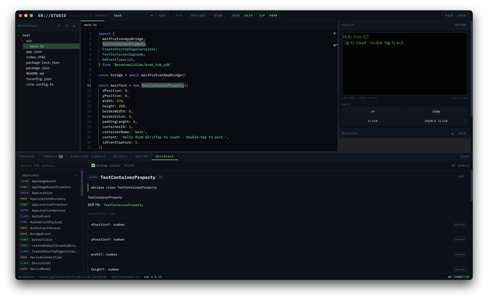

<div align="center">

<picture>
  <source media="(prefers-color-scheme: dark)" srcset="img/readme/banner-dark.svg">
  
</picture>

<p>
  <a href="#install"><b>Install</b></a> ·
  <a href="#what-you-get"><b>What you get</b></a> ·
  <a href="#how-the-mirror-works"><b>How the mirror works</b></a> ·
  <a href="#architecture"><b>Architecture</b></a> ·
  <a href="CONTRIBUTING.md"><b>Contributing</b></a>
</p>

</div>

ER Studio is a **VS Code extension for building Even Realities G2 apps**. The simulator, an environment doctor and the SDK reference sit beside your code, so the whole loop happens in one window.



<picture>
  <source media="(prefers-color-scheme: dark)" srcset="img/readme/features-dark.svg">
  
</picture>

## Why it exists

The official Even Hub toolchain is solid: web SDK, desktop simulator, packaging CLI. The workflow it produces is fragmented, though. You write code in your editor, run Vite in a terminal, launch the simulator in its own window and read logs somewhere else: four surfaces for one task, rearranged by hand on every run.

Android developers have had the alternative for a decade: write code, press Run, see the device screen next to the editor. Nothing like that existed for the G2, so I built it.

ER Studio doesn't replace the official tools; it orchestrates them. Under the hood it drives the real `evenhub-simulator`, the real Vite dev server and the real `evenhub-cli`. You just never have to touch them directly.

## Install

You need Node 18+ (Even's docs recommend 20 LTS or 22+) and the Even Hub tooling. The Doctor panel offers to install anything that's missing:

```bash
npm i -g @evenrealities/evenhub-simulator @evenrealities/evenhub-cli
```

Then build the extension:

```bash
git clone https://github.com/gabrielevierti/er-studio
cd er-studio
npm install
npm run package        # -> apps/vscode/er-studio-<version>.vsix
```

In VS Code, open the Extensions sidebar → `…` → **Install from VSIX**. To run it from source instead, open `apps/vscode` in VS Code and press **F5**.

## What you get

Click the glasses icon in the activity bar. ER Studio asks where your projects should live, offers to create one if the folder is empty, and lays out the workspace:

| Area | What's there |
| --- | --- |
| **Left** | ER Studio controls, with your projects tree below them |
| **Right** | Simulator and Webview as editor tabs, with Run, Stop, Restart and Capture on the simulator's own toolbar |
| **Bottom** | Console · Simulator Console · SDK Reference · Doctor, each in its own tab |
| **Status bar** | Even Realities SDK version, run state, active project |

The SDK reference follows your cursor: put the caret on a symbol in a `.ts` or `.js` file and it jumps to that entry.

The editor, file tree and terminal are VS Code's own. Reimplementing them would only have made the product worse.

## How the mirror works

The simulator is a native LVGL window and can't be embedded. Since v0.7.0, though, it ships an HTTP automation control plane: launched with `--automation-port`, it exposes the framebuffer as a PNG, the app's console buffer, and TouchBar input injection over plain HTTP.

ER Studio runs it as a hidden child process and rebuilds the experience on top of that API. The pixels are the simulator's pixels, the input is real input, and the logs are your app's real logs. Nothing is emulated or faked.

The input pad covers the hardware gestures, including a **long press** that behaves like the real one: press and release are two separate events (`long_press`, `long_press_release`), so hold-to-confirm apps work as they will on the glasses.

## Architecture

```
packages/core     server, panel UI, doctor, SDK reference   <- all the logic
apps/vscode       the extension                             <- host surfaces only
```

The extension reimplements nothing. Each panel is framed from `/embed?panel=<id>`, the same page the core server serves minus the editor chrome, so a fix to a panel reaches every surface at once and they can't drift apart.

`npm start` serves the same UI in a browser at `http://127.0.0.1:4477`; that is what **ER Studio: Open Full UI in Browser** opens, and where the editor and terminal panels still live for anyone who wants them.

The details are in [ARCHITECTURE.md](ARCHITECTURE.md), and the development loop in [CONTRIBUTING.md](CONTRIBUTING.md).

## Tests

```bash
npm test
```

Runs the real server and the real extension against a stand-in for the `vscode` module. Nothing below the extension layer is mocked.

## History

Up to v0.1.4, ER Studio was a standalone Electron app. The VS Code extension replaced it: marketplace distribution beats an unsigned dmg, and VS Code already provides the editor, file tree, terminal and window management the Electron shell had to build by hand. The desktop app is still in the git history.

## License

MIT. See [LICENCE](LICENCE).

---

<sub>Made by <a href="https://github.com/gabrielevierti">Gabriele Vierti</a> in Milan. ER Studio is not an official Even Realities product.</sub>
